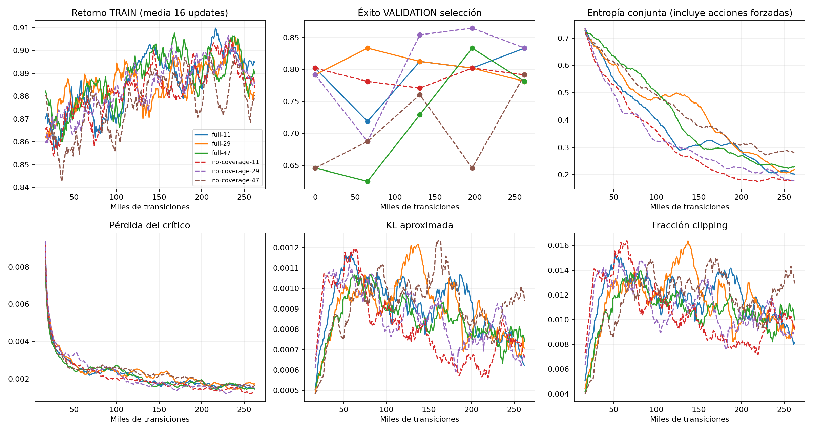
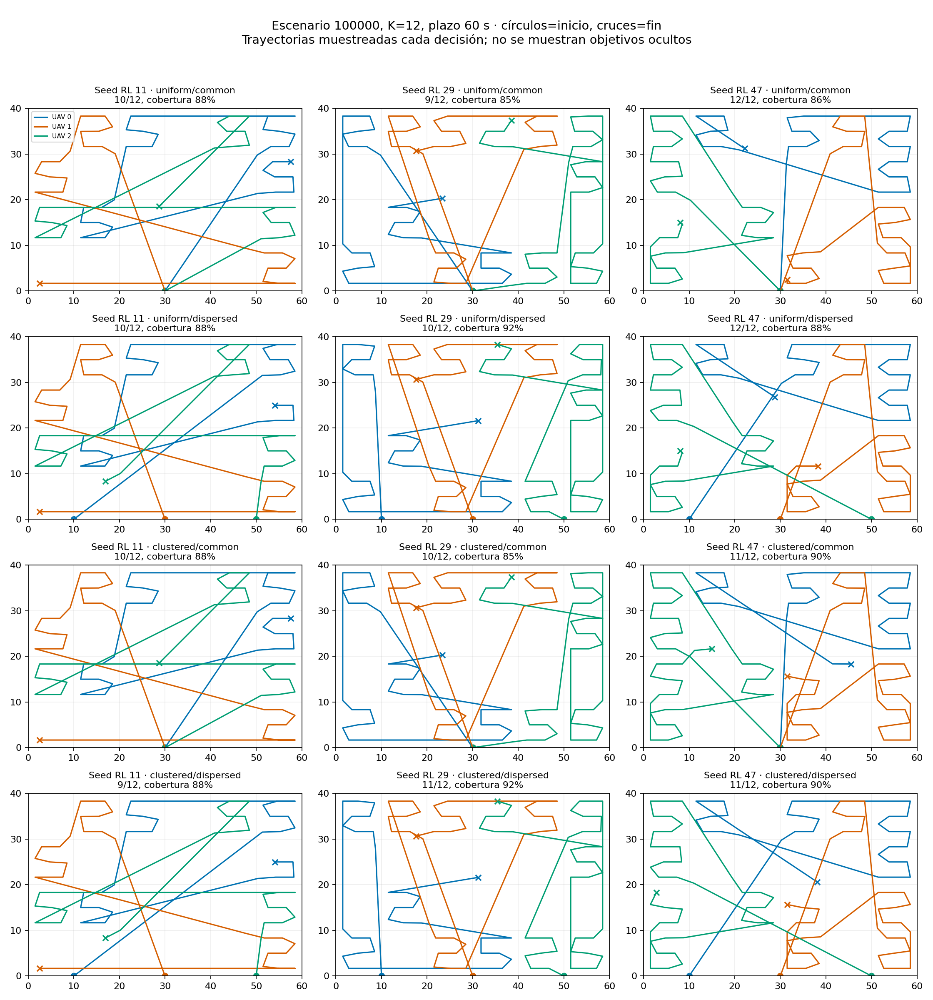
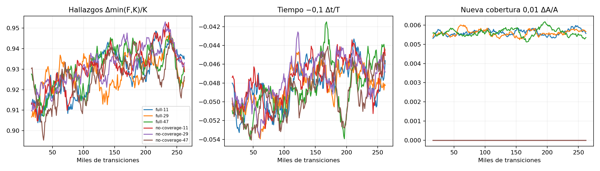

# Fase 4 — piloto PPO centralizado

**Respuesta: parcialmente.** PPO aprende una búsqueda útil y mejora sus inicializaciones, pero no demuestra cooperación adaptativa a los hallazgos. El reparto válido está parcialmente impuesto por el contrato; se aprenden sobre todo órdenes y preferencias espaciales. No hay superioridad general frente a A/B. La fase termina aquí.

El entorno, A/B, sensores, inicios, métricas y protocolo anteriores conservan sus hashes. Se utilizaron únicamente TRAIN y VALIDATION; TEST no se ha usado. No se modificó la recompensa completa durante su ejecución. La ablación cambia exclusivamente el coeficiente de cobertura a cero.

## Configuración y presupuesto

PPO centralizado, MLP compartida actor/crítico 128–128 tanh, 167 entradas públicas, tres categóricas de 25 acciones con exclusión secuencial de regiones, incluyendo espera. Rejilla 6×4 configurable por ejecución/checkpoint; física y escenarios congelados. Actor y crítico solo ven `SearchObservation`. Sin memoria ni identificación de distribución.

Tres semillas (11, 29, 47), 262.144 transiciones cada una; 786.432 con recompensa completa y otras 786.432 en la ablación. Ocho entornos ×128 pasos, 4 épocas, minibatch 256, Adam 3e-4, γ=0,99, λ=0,95, clip=0,2, entropía=0,01, value coefficient=0,5 sobre 0,5·MSE, grad clip=0,5, KL límite=0,03. CPU con un hilo Torch. [Configuración exacta](../config.json) y [formulación/reproducción](../README.md).

TRAIN varía semillas 0–79999, N=6/12/24, K=3/N, plazo 60/120, uniforme/clustered e inicio común/disperso. Selección cada 65.536 pasos entre checkpoint inicial y cuatro checkpoints, en 96 episodios VALIDATION (100100–100101). Criterio: éxito, después tiempo restringido. Comparación final: los 4.800 escenarios exactos de A/B por política, semillas 100000–100099, sin reseleccionar checkpoint.

## Aprendizaje y estabilidad

| Seed | Éxito inicial → seleccionado (96 episodios) | Paso seleccionado | Tiempo restringido inicial → seleccionado |
|---|---|---|---|
| 11 | 80.21% → 83.33% | 262,144 | 43.22 → 36.87 s |
| 29 | 79.17% → 83.33% | 65,536 | 41.62 → 36.64 s |
| 47 | 64.58% → 83.33% | 196,608 | 48.32 → 34.40 s |

Las seeds 29 y 47 empeoran después de su mejor checkpoint. La mejora no es monotónica y seleccionar un checkpoint importa. El éxito inicial ya es alto: el ejecutor de barrido y las máscaras aportan gran parte de la capacidad de búsqueda. La mejora media en selección es +8,68 puntos porcentuales, suficiente para la puerta de ablación fijada antes de entrenar, pero no para afirmar convergencia.

Curvas TRAIN suavizadas sobre 16 updates; selección VALIDATION sin suavizar. Entropía incluye decisiones forzadas de UAV ocupados, por lo que su valor bajo no prueba por sí solo colapso de la política. Las curvas y pérdidas completas se conservan por seed.

## Validación emparejada: métricas físicas

Tabla descriptiva del conjunto equilibrado de 48 condiciones, 4.800 episodios por fila. Tiempo restringido = tiempo hasta K o plazo en fallos. No confundir el tiempo a K condicionado a éxito con una comparación sobre todos los episodios.

| Estrategia | Éxito | Primer hallazgo (s) | Hasta K, solo éxitos (s) | Tiempo restringido (s) | Cobertura | Distancia (m) | Redundancia (m²·s) |
|---|---|---|---|---|---|---|---|
| A-systematic | 85.25% | 5.68 | 32.24 | 36.34 | 57.28% | 417.3 | 3014.7 |
| B-coordinated | 83.02% | 7.54 | 34.28 | 38.65 | 56.57% | 441.7 | 3170.5 |
| full-11 | 81.06% | 4.10 | 34.08 | 38.99 | 57.77% | 455.4 | 3267.9 |
| full-29 | 82.04% | 4.51 | 34.00 | 38.72 | 57.68% | 440.5 | 3165.9 |
| full-47 | 84.12% | 4.21 | 31.98 | 36.43 | 57.78% | 423.5 | 3037.1 |

Entre seeds PPO: éxito medio **82.41%**, desviación estándar muestral **1.56 pp**; tiempo restringido **38.05 ± 1.41 s**. Tres semillas solo permiten una estimación preliminar de estabilidad. No se tratan 14.400 episodios correlacionados como 14.400 réplicas independientes del entrenamiento.

PPO encuentra antes el primer objetivo, pero completar K resulta menos sólido. A supera a las tres políticas en éxito global; la seed 47 se aproxima a su tiempo restringido. Estos promedios no sustituyen el análisis por condición: [métricas por condición](conditions.csv), [diferencias emparejadas e IC95 por condición](paired.csv) y [todos los resultados](results.json). IC t aproximados sobre 100 semillas por condición, sin corrección por comparaciones múltiples; lectura exploratoria. El primer hallazgo de B se observa en 4.798/4.800 episodios; los demás en todos.

## Uniforme frente a clustered

| Estrategia | Éxito uniforme | Éxito clustered | Tiempo restringido uniforme / clustered |
|---|---|---|---|
| A-systematic | 83.29% | 87.21% | 36.61 / 36.06 s |
| B-coordinated | 80.58% | 85.46% | 39.05 / 38.24 s |
| full-11 | 80.71% | 81.42% | 39.17 / 38.81 s |
| full-29 | 80.88% | 83.21% | 39.61 / 37.83 s |
| full-47 | 82.42% | 85.83% | 37.19 / 35.66 s |

Una diferencia de rendimiento entre distribuciones no demuestra adaptación. En las trayectorias representativas, las preferencias de regiones cambian poco entre uniforme y clustered. En el diagnóstico de permutar los conteos de hallazgos entre regiones ya cubiertas, las decisiones no cambian:

- full-11: 0/115 decisiones modificadas.
- full-29: 0/119 decisiones modificadas.
- full-47: 0/111 decisiones modificadas.

Es una muestra pequeña y una intervención sobre observaciones, no una prueba exhaustiva ni causal. Sugiere que el vector de hallazgos regionales se utiliza poco. No hay evidencia convincente de concentración deliberada alrededor de detecciones.

## Trayectorias y distribución del trabajo

Selección previa al análisis: escenario 100000, N=K=12, plazo 60 s, ambas distribuciones e inicios; columnas = seeds de entrenamiento. La galería incluye éxitos y fallos. JSON adicionales incluyen K=3 y plazo 120 s. Los puntos se muestrean por decisión, por lo que los pequeños zigzags no representan exactamente cada tramo físico.

- Existe reparto espacial parcial: por ejemplo, seed 47 mantiene al UAV verde principalmente a la izquierda. Sin embargo, aparecen cruces largos entre regiones y transitamos repetidamente por terreno cubierto. No se aprende una partición compacta consistente.
- Regiones completadas nunca se reasignan porque el entorno lo prohíbe; tampoco se puede interrumpir un barrido. La ausencia de oscilaciones de reasignación no es un mérito aprendido de PPO.
- Seed 29 presenta más esperas del UAV 0. Las otras dos mantienen casi siempre ocupados los UAV mientras quedan regiones. No se observan esperas persistentes generalizadas para acumular recompensa.

| Seed | Distancia por UAV (m) | Área nueva por UAV (m²) | Hallazgos por UAV | Ocio por UAV (s) | Espera voluntaria entre decisiones libres |
|---|---|---|---|---|---|
| full-11 | 151.97 / 152.32 / 151.12 | 459.42 / 491.05 / 435.96 | 2.57 / 2.90 / 2.60 | 0.00 / 0.00 / 0.00 | 0.00% |
| full-29 | 139.89 / 149.77 / 150.90 | 446.05 / 479.95 / 458.33 | 2.57 / 2.84 / 2.69 | 3.07 / 0.12 / 0.00 | 24.56% |
| full-47 | 141.66 / 139.39 / 142.48 | 436.16 / 458.30 / 492.20 | 2.55 / 2.65 / 2.99 | 0.00 / 0.04 / 0.00 | 0.05% |

Área nueva y hallazgos tienen el desempate por índice heredado del motor. El ocio solo cuenta intervalos completos de decisión. No interpretar esas atribuciones como calidad individual de cada UAV.

## Recompensa y posibles atajos

Los tres términos se calculan exclusivamente con diferencias de observaciones. Las pruebas verifican telescopado: espera/revisita sin hallazgos ni área nueva no da ganancia; hallazgos se saturan en K y la cobertura total aporta como máximo 0,01. El retorno total de un episodio está acotado aproximadamente entre −0,1 y 1,01 (los hallazgos iniciales no se recompensan de nuevo).

| Política completa | Hallazgos | Tiempo | Cobertura | Retorno medio VALIDATION (solo diagnóstico) |
|---|---|---|---|---|
| full-11 | 0.93993 | -0.04687 | 0.00564 | 0.89870 |
| full-29 | 0.94292 | -0.04657 | 0.00563 | 0.90198 |
| full-47 | 0.94920 | -0.04437 | 0.00564 | 0.91048 |

No se detecta explotación evidente de cobertura repetida, esperas o información oculta. Sí hay **desalineación potencial**: conseguir casi K proporciona casi todo el término positivo aunque la misión falle, sin bonus especial por completarla. El descuento γ=0,99 favorece ganancias tempranas. Esto es compatible con primeros hallazgos rápidos y peor éxito final; no prueba por sí solo reward hacking. No se cambió la recompensa para corregirlo durante el piloto.

## Ablación sin cobertura

Se repitió el presupuesto completo con las mismas seeds y selección, cambiando únicamente 0,01 → 0. El retorno no se usa para comparar variantes.

| Seed | Éxito completa / sin cobertura | Tiempo restringido completa / sin cobertura | Checkpoint sin cobertura |
|---|---|---|---|
| 11 | 81.06% / 82.75% | 38.99 / 37.09 s | 196,608 |
| 29 | 82.04% / 84.21% | 38.72 / 37.08 s | 196,608 |
| 47 | 84.12% / 82.27% | 36.43 / 37.00 s | 262,144 |

Diferencia sin cobertura − completa: **+0.67 pp** de éxito medio, SD entre las tres diferencias **2.20 pp**. La variante conserva búsqueda funcional; los cambios dependen de la seed. Esta ablación pequeña no permite atribuir la cooperación al shaping ni concluir equivalencia. Las curvas muestran la variabilidad y posibles degradaciones tardías.

## Coste real y comprobaciones

Windows, Ryzen 7 9800X3D, Python 3.12.14, Torch 2.6.0+cpu, .NET SDK 8.0.318. GPU de entrenamiento: **ninguna**; no se usó la RTX 3090. Ocho procesos de entorno por ejecución, un hilo Torch; procesos del equipo y algunas evaluaciones coincidieron temporalmente, así que el throughput no es una prueba de hardware aislada.

| Ejecución | Tiempo real incluyendo selección (s) | Transiciones/s, rollout + actualización | CPU Python + entornos (s) | Pico RSS combinado (MiB) |
|---|---|---|---|---|
| full-11 | 78.2 | 3653 | 79.2 | 934 |
| full-29 | 81.7 | 3482 | 83.1 | 934 |
| full-47 | 89.1 | 3195 | 90.7 | 935 |
| no-coverage-11 | 86.7 | 3276 | 89.4 | 934 |
| no-coverage-29 | 81.3 | 3500 | 83.1 | 934 |
| no-coverage-47 | 80.3 | 3566 | 81.9 | 935 |

Suma de tiempos de las seis ejecuciones: **8.29 min**; consumo CPU acumulado medido **8.46 CPU-min**. Incluye validación para seleccionar checkpoints; excluye instalación, desarrollo, evaluación final, exportación y elaboración del informe. Los archivos por ejecución desglosan rollout, optimización y validación. No sumar tiempos solapados como duración total de la sesión.

Pruebas de fase 4: seis tests de frontera de información, codificación K/plazo, prohibición de TEST, máscaras/probabilidades/gradientes, recompensa/telescopado y rejilla alternativa. Exportación C# comprobada en las tres políticas completas: 2.046 observaciones, 48 episodios con igualdad exacta de métricas Python/C#, y 96 escenarios A/B repetidos por política. Error máximo de logits <1,6e-6; decisiones idénticas. Las fuentes congeladas se verifican al iniciar/finalizar. Las métricas físicas de la reevaluación tras corregir el contador auxiliar de esperas permanecen iguales.

Los 13 tests Unity aprobados en fase 3 siguen siendo antecedentes sobre el código congelado; no se ha modificado el runtime Unity durante esta fase. Logs y checkpoints locales están en `Experiments/results/ppo`; resúmenes, configuraciones y trazas están archivados junto a este informe. [Dependencias exactas](../requirements-lock.txt).

## Decisión recomendada

**Mantener PPO provisionalmente**, sin avanzar automáticamente ni afirmar que el método definitivo sea PPO. El entorno permite aprendizaje, el coste es bajo y no hay un fallo numérico que obligue a cambiar de algoritmo. Sin embargo, esta formulación produce principalmente una ordenación espacial relativamente estática, con estabilidad limitada y débil uso de detecciones.

Antes de MARL, conviene autorizar un diagnóstico específico de sensibilidad a hallazgos, capacidad de la representación y correspondencia entre éxito de misión y objetivo descontado. También distinguir qué parte del reparto la imponen las máscaras y el ejecutor. Cambiar recompensa, observaciones, acciones, presupuesto o algoritmo requiere otro experimento acordado; ninguno se ha cambiado para hacer ganar a PPO. MAPPO/QMIX y las demás ampliaciones excluidas no se han introducido.
