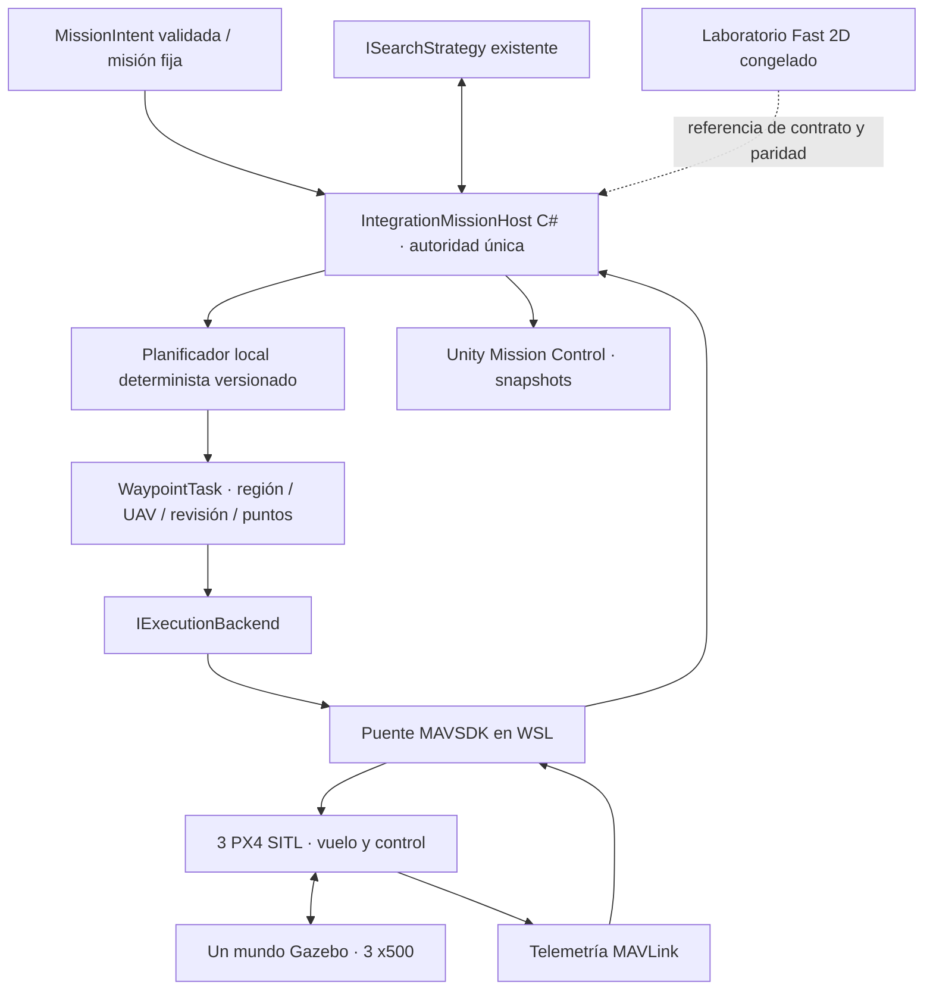

# PX4 SITL / Gazebo — inspección y propuesta, 17-09-2026

**Estado actual: decisiones aprobadas y slice mínimo aceptado.** Véanse [REPORT.md](REPORT.md) y [acceptance-result.json](acceptance-result.json): tres UAV, baseline A, telemetría y cierre verificados. El laboratorio RL permanece congelado. El resto de este documento conserva la inspección y propuesta originales, anteriores a la autorización; las menciones a instalaciones o implementación pendientes describen aquel momento, no el estado actual.

## 1. Arquitectura encontrada

| Código actual | Responsabilidad | Reutilización |
|---|---|---|
| `Assets/Swarm/MissionIntent.cs`: `MissionIntent`, `Scenario` | Intención y descriptor de mundo | Reutilizar DTO/validación; descriptor solo en la autoridad de misión |
| `ISearchStrategy.Reset/Decide(SearchObservation)` | Elegir regiones para tres UAV | Reutilizar sin cambiar contrato ni observaciones |
| `SystematicStrategy` | Baselines A/B | Referenciar su código congelado; inicialmente A |
| `Experiments/ppo/PolicyHost/ExportedPolicyStrategy.cs` | Inferencia de checkpoint existente | Reutilizable posteriormente sin entrenamiento; no necesaria para probar transporte |
| `SearchEnvironment.Step` | Validación conjunta, planificación, avance físico y finalización | **Acoplado**: no admite sustituir `Simulation` por telemetría |
| `SearchEnvironment.RegionRoute` | Barrido local determinista | Método privado, ligado a `simulation.Mission` |
| `Simulation.Step/Scan` | Movimiento ideal, detección y contabilidad | Conservar intacto; no usarlo para inventar movimiento PX4 |
| `SimulationRunner` | UI y propietario del simulador | `Update()` ejecuta `Simulation.Step()`; minimapa y exportación leen directamente la simulación |

El punto de abstracción correcto está **después del planificador local y antes de ejecutar waypoints**. La interfaz de estrategia existente no es una interfaz de vehículo. Tampoco basta con sustituir las posiciones dibujadas: el runner continuaría produciendo tiempo, detecciones y métricas ficticios.

## 2. Propuesta de desacoplamiento mínimo



La arquitectura anterior es **propuesta**, no instalada. El laboratorio 2D continúa por su camino actual. En este incremento no se refactorizaría su entorno para obligarlo a implementar la nueva interfaz.

Contratos nuevos propuestos, fuera de los archivos congelados:

- `WaypointTask`: `runId`, `missionRevision`, `taskId`, `vehicleId`, `regionId`, `frameId`, waypoints XY, secuencia, vencimiento. La altura de vuelo pertenece a la configuración del backend, no a la acción RL.
- `IExecutionBackend`: conectar, comprobar preparación, ejecutar tarea, solicitar hold/land y emitir telemetría/progreso. Asíncrono: aceptación de una orden no implica haber llegado.
- `VehicleSnapshot`: identidad PX4, posición/velocidad, armed, modo, estado landed, salud/validez de estimación, timestamps, tarea y waypoint actuales, error y antigüedad de datos.
- `MissionSnapshot`: misión, asignaciones, estado de los tres UAV, cobertura, hallazgos conocidos, métricas y secuencia de publicación. Fuente exclusiva de Unity.

Reutilización de planificación sin romper el congelado: crear una **copia versionada de compatibilidad** del algoritmo `RegionRoute` en integración, con pruebas diferenciales contra el método original (reflexión solo en tests). No reemplazarlo por `MissionPlanner.Plan`: ese otro planificador genera barridos por fases y no es el mismo algoritmo. No modificar el método original para hacerlo público. Esta duplicación temporal es deuda explícita; una futura extracción compartida exigiría levantar el congelado y pasar las pruebas de paridad.

Igual criterio para proyección de observaciones/contabilidad: implementación de integración versionada y contrastada con el laboratorio, sin cambios en las fórmulas originales. No ejecutar una simulación 2D paralela para decidir qué habría detectado el vehículo ideal.

## 3. Decisión arquitectónica pendiente: Mission u Offboard

| Alternativa | Ejecución | Ventaja | Coste / diferencia |
|---|---|---|---|
| **Offboard de posiciones NED — recomendación** | Puente entrega el siguiente objetivo de posición; PX4 cierra los lazos de posición, actitud y motores | Encaja con tareas regionales dinámicas y geometría métrica local | El puente monitoriza llegada y mantiene enlace; necesita watchdog y política de pérdida de conexión |
| Mission mode | Subir lista de waypoints geográficos de cada tarea mediante MAVSDK Mission/MissionRaw | PX4 conserva y progresa por la misión embarcada | Conversión geodésica/altura; reemplazar y pausar misiones al cambiar de región; semántica de navegación/aceptación propia de PX4 |

MAVSDK ofrece subida, pausa y progreso de misiones; su finalización se monitoriza aparte del ACK de subida. [Guía oficial de misiones](https://mavsdk.mavlink.io/main/en/cpp/guide/missions.html).

Para Offboard hay API oficial de objetivos de posición NED. MAVSDK reenvía setpoints a 20 Hz; PX4 necesita un flujo continuo de al menos 2 Hz y un setpoint previo a entrar en modo. La pérdida de ese flujo activa el failsafe configurado. [Ejemplo oficial Python](https://github.com/mavlink/MAVSDK-Python/blob/main/examples/offboard_position_ned.py), [MAVSDK Offboard](https://mavsdk.mavlink.io/main/en/cpp/guide/offboard.html), [PX4 Offboard](https://docs.px4.io/main/en/flight_modes/offboard).

**No se ha elegido ni implementado ninguna opción.** En ambas, PX4 controla el vuelo. El coordinador no calcula actitudes, empujes, velocidades de rotor ni un controlador neuronal.

Si se aprueba Offboard: el puente mantiene una cola de waypoints por tarea, alimenta objetivos de posición y determina llegada con tolerancia y velocidad medidas (propuesta inicial: error horizontal ≤1 m, vertical ≤0,5 m, velocidad ≤0,5 m/s durante 0,5 s). Son parámetros operativos de integración, no cambios en el laboratorio. El host solo marca una región completada después del último waypoint confirmado, nunca por ACK o por cobertura aproximada. Habría límites temporales por tarea y una lease del host: no seguir reenviando indefinidamente una orden obsoleta aunque MAVSDK continúe vivo.

## 4. Tres PX4 en Gazebo

Propuesta: **un servidor Gazebo, tres modelos x500 y tres procesos PX4**, instancias 0/1/2, cada uno con directorio de ejecución/logs propio. La primera instancia puede arrancar Gazebo y las siguientes conectarse en modo standalone; también puede supervisarse Gazebo por separado. No lanzar tres mundos con tres comandos `make ... gz_x500`. La documentación oficial sitúa el multi-UAV Gazebo en Linux. [Multi-vehicle oficial](https://docs.px4.io/main/en/sim_gazebo_gz/multi_vehicle_simulation).

| UAV lógico | Instancia | MAV_SYS_ID esperado* | Puerto UDP receptor MAVSDK | gRPC privado |
|---|---:|---:|---:|---:|
| 0 | 0 | 1 | 14540 | 50051 |
| 1 | 1 | 2 | 14541 | 50052 |
| 2 | 2 | 3 | 14542 | 50053 |

*Verificar al conectar, no asumir por orden de descubrimiento. Rechazar IDs duplicados o diferentes del manifiesto de ejecución. En v1.17.0 los puertos offboard remotos derivan de `14540 + instancia`, y los locales de `14580 + instancia`. El puerto GCS no identifica por sí solo al vehículo. [Script de arranque fijado](https://github.com/PX4/PX4-Autopilot/blob/v1.17.0/ROMFS/px4fmu_common/init.d-posix/px4-rc.mavlink).

Un puente Python puede mantener tres objetos `System`, con servidor MAVSDK y puerto gRPC distinto por UAV. No compartir el puerto por defecto entre ellos. MAVSDK-Python incluye su servidor nativo y se comunica con él mediante gRPC. [Paquete oficial](https://pypi.org/project/mavsdk/).

Telemetría requerida: conexión/heartbeat, posición y velocidad NED, modo, armado, in-air/landed y salud del estimador; opcional posición global para comprobar el origen. Recuperar estado con suscripciones, no considerar terminada una orden porque su función devuelve éxito. [Telemetría MAVSDK](https://mavsdk.mavlink.io/main/en/cpp/guide/telemetry.html).

## 5. Coordenadas, alturas y preparación

Convención propuesta explícita: `(x,y)` del mapa = `(Este,Norte)` en metros. Configurar/verificar Gazebo con marco mundial ENU. Para referencia global `(E0,N0,U0)`, el punto del mapa y altura h se representa como Gazebo `(E0+x,N0+y,U0+h)`; en Unity 3D sería `(x,h,y)` y en el minimapa actual se mantiene la inversión vertical de pantalla existente.

**Cada PX4 tiene su propio origen local.** Antes de volar se asocia su posición local medida `(nᵢ,eᵢ,dᵢ)` a su referencia conocida `(xᵢ,yᵢ,hᵢ)` del mundo. Para un waypoint:

```text
north = nᵢ + (y − yᵢ)
east  = eᵢ + (x − xᵢ)
down  = dᵢ − (h − hᵢ)

x = xᵢ + (east − eᵢ)
y = yᵢ + (north − nᵢ)
h = hᵢ − (down − dᵢ)
```

Esto presupone ejes alineados con ENU/NED, comprobados mediante un desplazamiento conocido. Si se introduce una rotación de mundo se añade explícitamente a la transformación. No sumar la posición de spawn dos veces ni interpretar todos los NED como un marco compartido. Para yaw: grados NED desde norte horario; un yaw ENU desde este antihorario se convierte como `90° − yawENU`. Un reset del estimador invalida la referencia y detiene la sesión; no recalibrar silenciosamente con el UAV en movimiento.

Para el slice propongo usar una condición **ya existente** con inicios dispersos `(10,0),(30,0),(50,0)`, mundo 60×40, seed 100000, uniforme, N=12, K=12, plazo 120 s. No replicar tres cuerpos físicos en el mismo punto del inicio común. Propuesta de ejecución a aprobar junto al backend: capas de vuelo 5/8/11 m para evitar cruces de cuerpos; geometría de búsqueda continúa proyectada en XY y no pretende modelar sensores reales. Si se exige igual altura, haría falta acordar separación de tráfico; no incorporarla escondida en A/B.

Despegue/aterrizaje son estados operativos fuera del intervalo de búsqueda. Solo iniciar el reloj de búsqueda cuando los tres UAV estén preparados y estabilizados sobre sus inicios XY. El origen del mapa no se mueve para ocultar errores de posicionamiento. Esta barrera y las alturas son parámetros del slice de integración, no una nueva condición experimental RL.

## 6. Fuente de verdad, detecciones, métricas y tiempo

Un `IntegrationMissionHost` C# sería el único escritor de misión, asignaciones, hallazgos y métricas. El bridge solo entrega estado de ejecución; Unity solo representa snapshots y solicita operaciones. `runId/taskId/revision/sequence` permiten deduplicar ACKs y muestras; progreso jamás retrocede por paquetes tardíos.

El servicio de detección sintética conserva los objetivos ocultos fuera de `SearchObservation` y del puente de vuelo. Usa segmentos de posiciones reales estimadas recibidas por telemetría, proyectados en XY, con el radio/reglas del laboratorio. No hay cámara ni visión artificial; Gazebo no necesita marcadores visibles de objetivos. Los únicos puntos de objetivo publicados son hallazgos. La altura de integración no cambia el radio del sensor abstracto.

Contabilidad única sobre esas mismas muestras: cobertura por centros de celda, hallazgos únicos, distancia, tiempo y redundancia. Guardar original/transformado y timestamp para auditoría. La distancia real y la exposición no coincidirán con el motor ideal; nunca juntar esos resultados con CSV de validación PPO. Marcar `backend=px4-sitl`, versiones, marco, tolerancias, frecuencia y calidad de telemetría.

Mantener dos relojes: tiempo de simulación Gazebo para misión/métricas y monotónico real para watchdogs. Obtener el reloj de Gazebo mediante su transporte nativo (sin ROS 2) y documentar alineación con timestamps MAVLink. No sustituirlo por `Time.deltaTime` ni asumir que el tiempo desde boot es idéntico en las tres instancias. Esta alineación requiere validación en el slice. No puentear grandes huecos de telemetría con un segmento ficticio: marcar datos incompletos y abortar/invalidate la ejecución en lugar de otorgar cobertura inventada.

## 7. Unity como Mission Control

Propuesta de componente/escena de integración separado de `SampleScene`, donde el bootstrap actual no cree `SimulationRunner`. Dibuja región, rutas, posiciones, estado del enlace y hallazgos del host. No llama `Simulation.Step`, no genera objetivos ni exporta métricas independientes. Mantener presentación sencilla, sin rediseño grande.

Iniciar significa solicitar la sesión al host; interrumpir solicita hold/land según estado, no congela el tiempo ni los vehículos por cerrar la UI. Reiniciar implica terminar la sesión previa y crear otra, nunca teletransportar cuerpos en vuelo. Unity usa recepción asíncrona y solo aplica snapshots en su hilo principal; si el enlace envejece muestra estado desconocido, no movimiento interpolado como si fuera telemetría confirmada.

## 8. Infraestructura inspeccionada y dependencias propuestas

Hallazgos locales:

- Windows con Unity 6000.6.0f1 y SDK .NET 8.0.318 ya disponibles.
- WSL2 `Ubuntu`: Ubuntu **26.04.1**, usuario roman, Python 3.14 y git disponibles; no se localizaron `gz`, `px4` o `cmake` en PATH ni checkout `PX4-Autopilot` bajo `/home` y `/opt` hasta profundidad 4. No prueba ausencia en todo el disco.
- WSL2 `OpenClawGateway` ya estaba en ejecución; no se inspeccionó ni modificó esa distribución.
- Al iniciar la consulta de Ubuntu apareció un aviso de sesión systemd de usuario; no se intentó repararlo.
- No se encontraron procesos PX4/Gazebo en la inspección de Ubuntu, ni Unity/PX4/Gazebo en Windows. No se arrancaron para esta tarea.

Stack propuesto, **pendiente de aprobación e instalación**: distribución WSL2 Ubuntu **24.04 dedicada**, PX4 **tag v1.17.0** y submódulos fijados por ese tag, Gazebo **Harmonic (gz-sim 8)**, x500 del mismo checkout, Python 3.12 y venv independiente con **mavsdk==3.17.2**. Registrar hashes/versiones resueltas de paquetes antes del primer vuelo. No reutilizar ni alterar `Experiments/.venv`.

La documentación v1.17 identifica Ubuntu 22.04/24.04 como entornos soportados, y su instalador instala Harmonic; no se asume compatibilidad del Ubuntu 26.04 existente. Gazebo v1.17 admite otras versiones en 24.04, pero fijar Harmonic evita seleccionar accidentalmente la más nueva instalada. [Ubuntu PX4 v1.17](https://docs.px4.io/v1.17/en/dev_setup/dev_env_linux_ubuntu), [Gazebo PX4 v1.17](https://docs.px4.io/v1.17/en/sim_gazebo_gz/), [instalador del tag](https://github.com/PX4/PX4-Autopilot/blob/v1.17.0/Tools/setup/ubuntu.sh).

La instalación requiere descargar una distribución, repositorio con submódulos y paquetes de compilación/Gazebo: potencialmente varios GB; **no se ha calculado ni autorizado una descarga exacta**. El instalador usa sudo y añade repositorios/paquetes dentro de Linux. Por tus restricciones, no se ha ejecutado. No se cambiarán firewall, `.wslconfig`, red mirrored, recursos de otras distribuciones ni privilegios Windows sin aprobación específica.

Compilar PX4 dentro del filesystem Linux, no en `/mnt/c`, por rendimiento/permisos. Mantener MAVLink y los tres servidores MAVSDK dentro de WSL; cruzar a Windows únicamente un canal TCP de aplicación con mensajes versionados y límites. Probar localhost forwarding antes de proponer cambios de red. Gazebo headless evita depender inicialmente de WSLg; su GUI puede necesitar OpenGL/WSLg y recursos gráficos, sin entrenamiento GPU. [Guía WSL de PX4](https://docs.px4.io/main/en/dev_setup/dev_env_windows_wsl).

No se identifica necesidad técnica de ROS 2 para este slice. Docker o una VM Linux son alternativas si no se aprueba otra distribución WSL; añaden gestión de red y runtime. No se recomienda instalar esta pila directamente en OpenClawGateway ni actualizar/degradar el Ubuntu existente.

## 9. Pruebas de aceptación propuestas

| Prueba | Criterio |
|---|---|
| Integridad | Hashes del laboratorio y fase 4 idénticos antes/después; cero entrenamiento |
| Estrategia | Mismo `SearchObservation` reproducido → mismos IDs de región/UAV para A/B/PPO exportado |
| Planificador | Mismo estado, región y configuración → mismos waypoints que `RegionRoute` congelado, incluyendo empates y límites |
| Coordenadas | Ida/vuelta XY↔NED, los tres orígenes diferentes, signo vertical, yaw, límites y reset de origen |
| Estado | ACK no completa tarea; llegada final sí; comandos duplicados/tardíos no duplican trabajo; no asignar UAV ocupado |
| Identidad | Un comando al UAV 1 no altera destinos de 0/2; IDs y tres puertos únicos |
| Sensor/contador | Una traza sintética conocida produce las mismas detecciones/cobertura/distancia que las fórmulas congeladas; ningún objetivo oculto en snapshots públicos |
| Telemetría | Muestras desordenadas/duplicadas/huecos no crean distancia ni cobertura artificial |
| Relojes | Pausar Gazebo pausa tiempo de misión; watchdog real sigue funcionando; despegue fuera de búsqueda |
| Unity | Cambiar framerate o desconectar UI no integra física ni duplica detecciones; muestra la misma revisión que el host |
| Slice real | Tres x500 en un mundo, identidades verificadas, tareas emitidas por estrategia existente, waypoints ejecutados y estado retornado hasta finalización/aborto explícito |
| Cierre | Aterrizaje/desarmado cuando sea posible y cierre de todos los PID/grupos propiedad de la sesión, también en timeout/excepción |

**No basta la misma misión para exigir la misma secuencia de decisiones en bucle cerrado.** La estrategia también ve posiciones, disponibilidad y hallazgos, que cambian con la física. La equivalencia exacta se verifica reproduciendo las mismas observaciones o una secuencia fija de tareas; en SITL se verifica respeto de asignaciones, orden, progreso y condiciones de finalización. No exigir curvas geométricas ni tiempos idénticos.

El backend abstracto de test sería un doble de ejecución por eventos, no otro simulador de entrenamiento ni un baseline nuevo. Los tests anteriores están definidos, no implementados ni ejecutados todavía.

## 10. Comandos, límites y cierre de esta inspección

Comandos de inspección realmente ejecutados (sin instalación):

```powershell
wsl --list --verbose
wsl -d Ubuntu -- bash -lc 'cat /etc/os-release'
wsl -d Ubuntu -- bash -lc 'type -a python3; type -a git; type -a cmake; type -a gz; type -a px4'
wsl -d Ubuntu -- bash -lc 'find /home /opt -maxdepth 4 -type d -name PX4-Autopilot 2>/dev/null'
```

También se comprobaron SHA256 de `Experiments/ppo/frozen.json` (7 entradas) y `Experiments/ppo/report/artifact-hashes.json` (18): **25/25 coinciden**, incluidos los seis checkpoints seleccionados. No se ejecutaron benchmarks, entrenamientos ni tests de vuelo. Las consultas WSL requirieron permiso para salir del aislamiento de la herramienta; no privilegios administrativos ni instalaciones.

Comandos upstream orientativos **no ejecutados**, solo tras aprobar/provisionar la distribución dedicada y fijar versiones:

```bash
git clone --branch v1.17.0 --recursive https://github.com/PX4/PX4-Autopilot.git
cd PX4-Autopilot
bash Tools/setup/ubuntu.sh --no-nuttx
make px4_sitl
```

No son todavía un comando de reproducción del slice. Falta implementar supervisor, puente, host y vista; publicar ahora un supuesto `run-slice` sería engañoso. El futuro supervisor impondrá máximo tres instancias y registrará sus PID/grupos; usará cleanup acotado a esa sesión, nunca `pkill` global ni `wsl --shutdown`, que podría afectar OpenClawGateway. Terminará Gazebo incluso si falla el segundo o tercer PX4. No desarmará forzadamente un vehículo en vuelo como procedimiento normal.

**Cambios de esta tarea:** únicamente `Integrations/Px4/DESIGN.md` e `inspection.json`. Dependencias añadidas: ninguna. Funciona: inspección y comprobación del congelado. No funciona todavía: backend PX4, puente MAVLink, tres vuelos simultáneos ni Unity remoto. Deuda pendiente: planificador/contador compatibles, timestamps/orígenes, lifecycle y tolerancias de ejecución, transporte y tests. No se hizo commit: el árbol conserva cambios previos de las fases anteriores; los manifiestos permiten comprobar su integridad sin agruparlos en un commit nuevo.

**Siguiente incremento mínimo, tras aprobación:** preparar Ubuntu 24.04 aislado y el stack fijado; validar contrato/transformaciones con un doble; probar conectividad primero con un vehículo y después con exactamente tres; ejecutar la misión fija con A y retorno de telemetría. Parar al alcanzar ese slice. PPO no se reentrena ni se modifica, y el backend Fast 2D continúa intacto.

Decisiones solicitadas: (1) Offboard de posiciones frente a Mission mode; (2) autorización para distribución WSL dedicada y sus instalaciones/descargas; (3) aceptar capas 5/8/11 m como adaptación operativa explícita del slice, o detenerse para definir separación a una sola altura. Ninguna decisión está aplicada aún.
